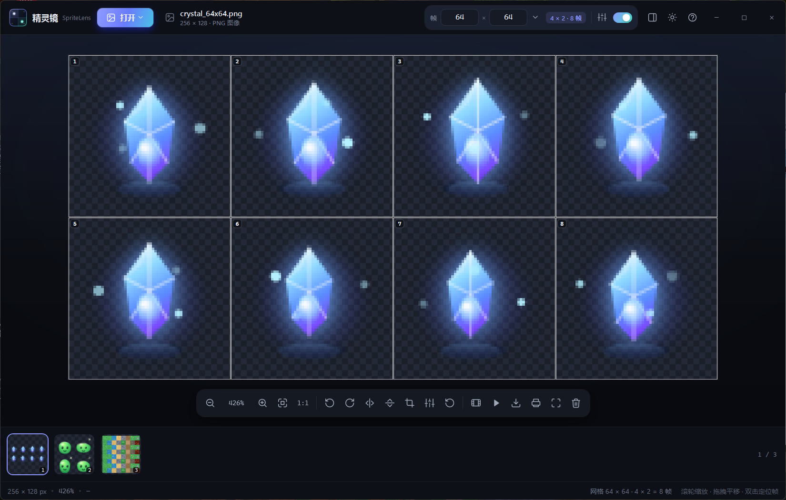
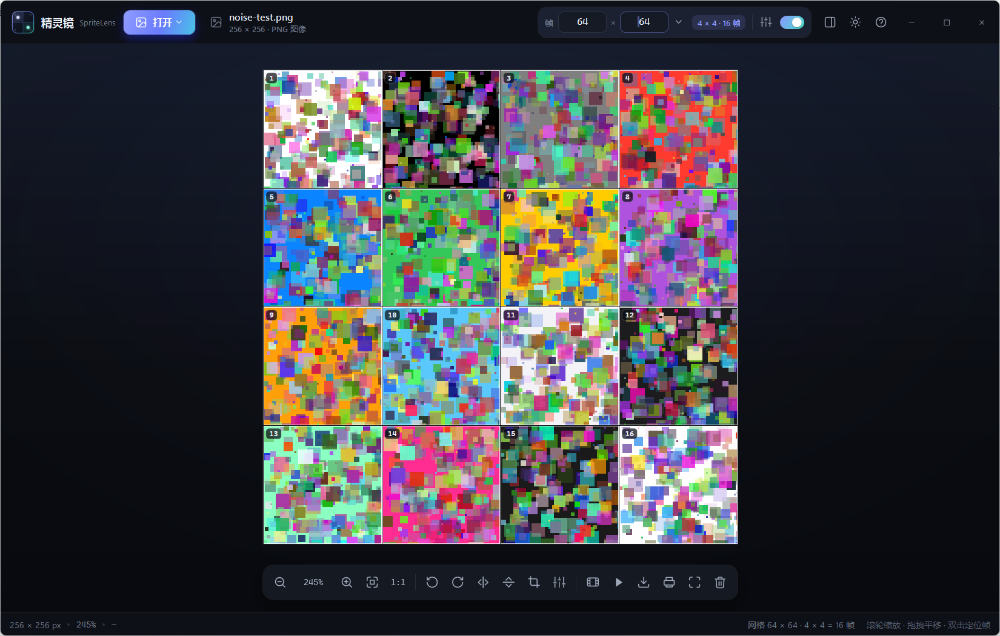
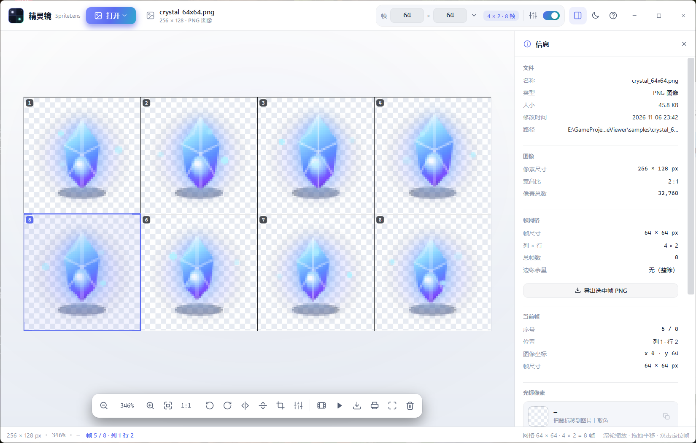
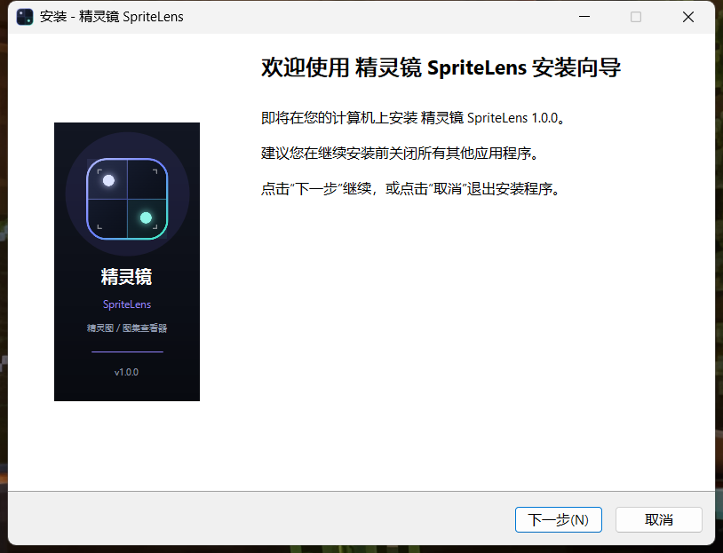

# 精灵镜 SpriteLens

一个 Windows 原生的精灵图 / 图集查看器。用 WPF + .NET 9 编写，不依赖浏览器、Electron 或任何第三方 UI 库。

主打两件事：**打开快**，以及**输入帧宽高后能立刻看清每一帧**。



## 功能

### 看图
- 打开单张图片、整个文件夹，或直接把文件/文件夹拖进窗口；也支持从剪贴板粘贴截图。
- 胶片栏快速切换同目录图片，左右方向键也可以切换。
- 滚轮缩放、拖拽平移、适应窗口、1:1 像素、像素锐利显示。
- 旋转 90°、水平翻转、垂直翻转、全屏、幻灯片播放。
- 幻灯片支持暂停、上一张/下一张、自动切换，播放时自动隐藏窗口边框和任务栏。
- 帧预览小窗：按设定的帧尺寸裁出当前帧并循环播放，适合检查逐帧动画。

### 帧网格（核心）
在顶部输入 **帧宽 × 帧高**，图片上会立即画出明显的分割线，不会改动原图。

例如一张 64 × 64 的图，输入 32 × 32，就得到 2 × 2 = 4 帧：



- 三种线型：双色（默认，白色光晕 + 深色实线）、虚线、强调色；线宽 1–3 px。
- **双色线在任何底色上都能看清**：浅色区域看到深色实线，深色区域看到白色光晕。
- 可开关网格、帧编号；帧编号在左上角，带深色半透明底，不遮挡画面。
- 点顶部的「网格样式」按钮，可以切换线型、线宽、帧编号和高亮；背景在信息面板里切换。
- 顶部会显示当前网格是几列几行、共几帧、有没有边缘余量。
- 帧尺寸会按图片路径记住；文件名里带 `_32x32`、`_64x64` 这类标记时，加载后会自动识别。
- 常用预设：8～256 的方形尺寸，以及“交换帧宽/帧高”“清除帧尺寸”。

### 信息与取色
- 信息抽屉显示文件名称、格式、大小、修改时间、完整路径、图像尺寸、宽高比、像素总数、帧尺寸/列数/行数/余量、当前帧坐标。
- 鼠标移到画面上，实时显示光标下的像素坐标、颜色、十六进制值和 RGB，可一键复制颜色值。
- 当前帧的像素坐标按帧内坐标显示，方便定位精灵的锚点。

### 编辑（不破坏原文件）
所有编辑都只作用于内存里的工作副本，原文件不会被改动；导出/打印时才写出新文件。

- 裁剪：自由比例、1:1、当前帧、4:3、16:9；可以拖动边角或整体移动裁剪框。
- 颜色调整：亮度、对比度、饱和度，带实时预览。
- 撤销上一步编辑（旋转/翻转/裁剪），或一键还原所有编辑。
- 调整和编辑会叠加显示；帧网格始终基于当前显示尺寸计算。

### 输出与文件操作
- 导出当前帧为 PNG。
- 导出整张图（含当前编辑）为 PNG。
- 导出带网格线的 PNG，方便做切图参考或发给同事。
- 打印（系统打印对话框，带网格预览）。
- 复制当前显示图到剪贴板。
- 设为桌面壁纸（使用当前显示效果）。
- 在资源管理器中定位文件。
- 重命名、删除（默认移入回收站；系统回收站不可用时才永久删除，确认框会明确提示）。

### 外观
- 深色/浅色两套主题，可随时切换，设置会记住。
- 无系统标题栏的圆角窗口，自定义最小化/最大化/关闭按钮；支持拖动、双击标题栏最大化、Win+方向键。
- 棋盘格透明背景，可切换为深色、浅色、纯黑、纯白。
- 空状态、加载提示、Toast 通知、自定义确认框/重命名框/帮助面板，全部使用同一套视觉语言。

浅色主题：



## 运行

### 安装版（推荐）
双击 `dist\installer\SpriteLens-Setup-1.0.0-x64.exe`，按向导安装。



- 自带 .NET 运行时，目标机器不需要额外安装 .NET 9。
- 安装时可选择“为所有用户安装”（需要管理员）或“仅为我安装”；可创建桌面快捷方式；可选把精灵镜加入图片的“打开方式”列表（不会修改默认程序）。
- 支持中文/英文安装向导；卸载在“设置 → 应用”里，或开始菜单的卸载快捷方式。
- 安装包没有做代码签名，首次运行 Windows SmartScreen 可能提示“Windows 已保护你的电脑”；点“更多信息 → 仍要运行”即可。
- 卸载会清理 App Paths 和“打开方式”注册项；个人设置保留在 `%LOCALAPPDATA%\SpriteLens`。
- 安装向导的简体中文翻译来自 Inno Setup 官方翻译（Zhenghan Yang）。

### 免安装版
1. 安装 [.NET 9 Desktop Runtime](https://dotnet.microsoft.com/download/dotnet/9.0)（Windows x64）。
2. 双击 `dist\SpriteLens.exe`。

也可以把图片拖到 exe 上，或在命令行传入路径：

```powershell
.\dist\SpriteLens.exe .\samples\slime_32x32.png
```

### 从源码运行 / 构建

```powershell
dotnet build -c Debug
dotnet run -c Debug
```

发布（框架依赖，体积小，需要 .NET 9 Desktop Runtime）：

```powershell
dotnet publish SpriteLens.csproj -c Release -r win-x64 --self-contained false -o dist
```

发布为独立单文件（体积大，但目标机器不需要安装 .NET）：

```powershell
.\发布.ps1 -SelfContained
```

如果 PowerShell 阻止脚本执行：

```powershell
powershell -ExecutionPolicy Bypass -File .\发布.ps1
```

### 重新制作安装包

安装包用 [Inno Setup 6](https://jrsoftware.org/isinfo.php) 生成，要求 Windows 和 Inno Setup 6：

```powershell
winget install JRSoftware.InnoSetup
.\installer\build-installer.ps1
```

脚本会先把应用发布成自包含目录（不需要 .NET 运行时），再生成安装向导图片并调用 `ISCC.exe`：

- 输出：`dist\installer\SpriteLens-Setup-1.0.0-x64.exe`
- 校验：同目录的 `.sha256` 文件
- 生成目录：`installer\payload\`、`installer\assets\`（已忽略，不提交）

只重新编译 Inno 脚本（复用已有 payload）可加 `-SkipPublish`。

## 快捷键

| 快捷键 | 作用 |
| --- | --- |
| Ctrl + O | 打开图片 |
| Ctrl + Shift + O | 打开文件夹 |
| Ctrl + V | 从剪贴板粘贴图片 |
| Ctrl + S | 打开导出菜单 |
| Ctrl + P | 打印 |
| Ctrl + Z | 撤销上一步编辑 |
| ← / → | 上一张 / 下一张图片 |
| `[` / `]` | 上一帧 / 下一帧 |
| + / - | 放大 / 缩小 |
| 0 | 适应窗口 |
| 1 | 100% 像素 |
| G | 显示/隐藏网格 |
| L | 显示/隐藏帧编号 |
| T | 切换深色/浅色主题 |
| I | 打开/关闭信息面板 |
| C | 裁剪 |
| A | 颜色调整 |
| P | 帧预览 |
| S | 幻灯片 |
| F | 全屏 |
| R / Shift + R | 顺时针 / 逆时针旋转 90° |
| H / V | 水平 / 垂直翻转 |
| Delete | 删除当前图片（回收站） |
| ? 或 F1 | 快捷键帮助 |
| Esc | 退出全屏/幻灯片/裁剪/弹窗，或取消选择 |
| 空格 | 幻灯片暂停/继续 |
| Enter | 裁剪模式下应用 |
| 双击画布 | 定位并选中该帧 |

## 项目结构

```
SpriteLens.csproj           WPF 项目（net9.0-windows）
App.xaml / App.xaml.cs      应用启动、主题、全局错误处理
MainWindow.xaml             窗口布局与全部面板
MainWindow.xaml.cs          窗口、打开文件、帧输入、缩放/旋转、主题、快捷键
MainWindow.Tools.cs         裁剪、调整、预览、幻灯片、导出/打印、撤销
MainWindow.Info.cs          信息抽屉的代码构建与刷新
MainWindow.Dialogs.cs       帮助/确认/输入弹窗
MainWindow.Presentation.cs  无边框全屏与窗口状态恢复
Controls/SpriteView.cs      画布：缩放、平移、网格、帧高亮、裁剪框
Controls/FramePreview.cs    帧预览绘制
Controls/Icon.cs            矢量图标控件
Core/ImageLoader.cs         WIC 解码、EXIF 方向、冻结位图、缩略图
Core/ImageDocument.cs       原图/工作图/显示图、编辑栈、调整、撤销
Core/EditPipeline.cs        旋转/翻转/裁剪/颜色调整
Core/FrameGeometry.cs       帧网格计算（列/行/余量/帧矩形）
Core/ImageExport.cs         帧/整图/带网格 PNG、打印
Core/AppSettings.cs         设置持久化
Core/ThemeManager.cs        运行时主题切换
Core/NativeMethods.cs       圆角、回收站、壁纸、资源管理器定位
Styles/                     控件样式与矢量图标
Themes/                     深色/浅色配色
samples/                    示例精灵图（内嵌为“载入示例”）
docs/                       README 截图
installer/SpriteLens.iss    Inno Setup 6 安装脚本
installer/build-installer.ps1  自包含发布 + 向导图生成 + 编译安装包
installer/安装说明.txt       安装版快速上手
installer/Languages/        安装向导简体中文
```

## 设计说明

- **双色分割线**：网格由白色外描边和深色内核组成，无论下面是白色高光、黑色描边还是高饱和色块，都至少有一层保持对比度。虚线/强调色是另外两种可选风格。
- **网格不切文件**：输入帧宽高只影响显示和导出，源文件字节不变。
- **快速打开**：WIC 在后台解码；加载后复制成独立的冻结位图，后续裁剪/旋转/取色不再依赖解码线程，也不会因为原文件被占用而失败。
- **整数倍缩放**：放大时默认使用最近邻（像素锐利），缩小时使用高质量重采样；1:1 时每个像素对应一个屏幕像素。
- **非破坏性编辑**：旋转/翻转/裁剪记录为操作栈，从原图重放；颜色调整在 CPU 上并行应用到显示副本。原图始终保留在内存中，撤销和“还原所有编辑”都从它重建。

## 已知限制

- WebP / HEIC 等格式依赖 Windows 已安装的 WIC 编解码器；PNG/JPG/BMP/GIF 在 Windows 10/11 上开箱即用。
- GIF 只显示第一帧（本项目不是 GIF 播放器）；如果把它当雪碧图并设置帧尺寸，可以用帧预览/幻灯片逐帧查看。
- 幻灯片和全屏会置顶覆盖任务栏，按 Esc 退出。
- 编辑只保存在内存中；关闭前请导出，或使用“导出整张图”/打印。
- 安装包未做代码签名，SmartScreen 可能提示；安装程序只可选加入“打开方式”，不会修改默认图片程序。
- 没有实现系统“分享”面板、锁屏幻灯片和触摸板双指手势；这些需要额外的 Shell/UWP 集成，当前版本聚焦本地查看、切图和导出。
- 多显示器下全屏以主显示器为准。


